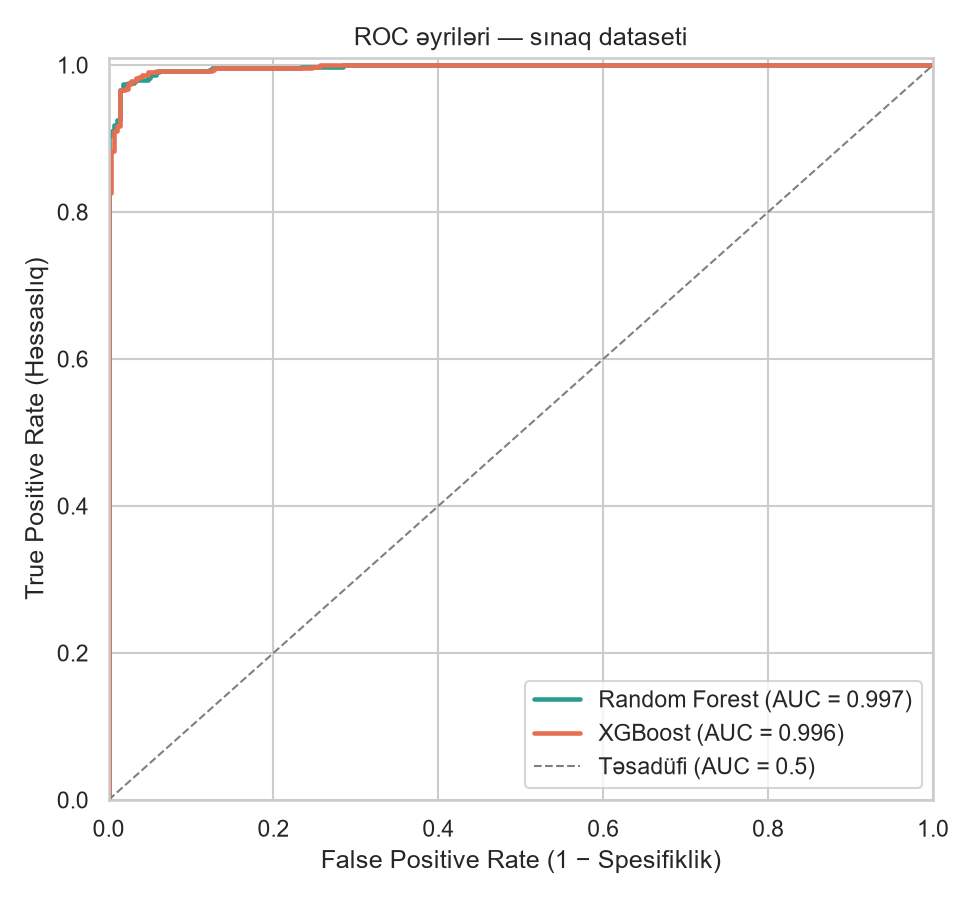
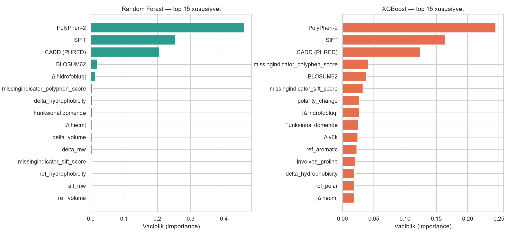

# 🧬 Machine Learning Classification of Genetic Variants and Prediction of Pathogenic Mutations

A Random Forest and XGBoost pipeline that classifies missense variants as
**Pathogenic (1) / Benign (0)** based on ClinVar labels.

## Project Structure

```
variant-pathogenicity-ml/
├── main.py                  # End-to-end pipeline (4 steps)
├── interactive.py           # Type a mutation and get an instant prediction
├── requirements.txt
├── variant_ml/
│   ├── config.py            # Paths, amino acid properties, BLOSUM62, domain table
│   ├── data_loader.py       # STEP 1: ClinVar download / mock data, SNV + missense + label filtering
│   ├── features.py          # STEP 2: Amino acid features, scores, domain flag
│   ├── models.py            # STEP 3: 80/20 split, RF + XGBoost, RandomizedSearchCV
│   ├── evaluation.py        # STEP 4a: Metrics, ROC, confusion matrix, feature importance
│   └── predict.py           # STEP 4b: predict_variant_impact()
├── data/                    # ClinVar file and processed CSV (created automatically)
├── models/                  # Saved models (.joblib)
└── outputs/                 # Plots and metric CSVs
```

## Installation

```bash
python -m venv .venv && source .venv/bin/activate     # Windows: .venv\Scripts\activate
pip install -r requirements.txt
```

## Usage

```bash
python main.py --fast                         # ~30 sec quick test (synthetic data)
python main.py                                # full run (synthetic, 5000 rows, 20 iterations)
python main.py --source clinvar --download    # download real ClinVar data from NCBI (~400 MB)
python main.py --source clinvar --clinvar-path data/variant_summary.txt.gz
python main.py --source clinvar --scores-file data/vep_scores.csv
```

If ClinVar is unavailable, the code automatically falls back to synthetic data in the same format.

## Interactive Mode

```bash
python main.py --fast      # train the model first (once)
python interactive.py      # then check any mutation
```

```
Gene name [Enter = TP53]: TP53
Mutation (e.g. R248W): R248W
  Pathogenic probability :  99.94%  ██████████████████████████████
  Prediction             : Pathogenic
  Protein domain         : DNA-binding domain
```

## Inference

```python
from variant_ml.predict import load_model, predict_variant_impact

model = load_model()   # models/best_model.joblib
predict_variant_impact("R248W", gene="TP53", model=model, sift=0.0, polyphen=1.0, cadd=32)
# {'variant': 'TP53 p.R248W', 'pathogenic_probability': 0.9999, 'prediction': 'Pathogenic', ...}

predict_variant_impact("p.Arg175His", gene="TP53", model=model)   # without scores -> median imputation
```

Accepted formats: `R248W`, `p.R248W`, `Arg248Trp`, `p.Arg248Trp`.

## Results (synthetic data)

| Model | Accuracy | Precision | Recall | F1 | ROC-AUC |
|---|---|---|---|---|---|
| Random Forest | 0.973 | 0.980 | 0.978 | 0.979 | 0.997 |
| XGBoost | 0.977 | 0.984 | 0.980 | 0.982 | 0.997 |




## Important Notes

- **Synthetic results do not reflect real-world performance.** In the mock data, SIFT/PolyPhen/CADD
  scores are derived from the labels, so the AUC ≈ 0.997 is artificially high. It is meant for
  verifying code correctness.
- **Real ClinVar data does not include SIFT/PolyPhen/CADD columns.** Annotate them with Ensembl VEP
  or dbNSFP and pass them via `--scores-file` (columns: `gene, protein_change, sift_score,
  polyphen_score, cadd_phred`; `protein_change` format: `R248W`). If not provided, the model
  learns only from amino acid and domain features.
- **The domain table** (`config.FUNCTIONAL_DOMAINS`) is approximate and illustrative; for real work,
  use UniProt / InterPro / Pfam coordinates.
- **Data leakage:** variants from the same gene may appear in both training and test sets. For a
  stricter evaluation, a gene-level split (`GroupKFold`) is recommended.
- This model is not a clinical diagnostic tool; it is intended for research and educational purposes only.
